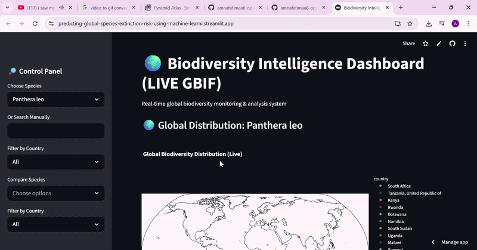
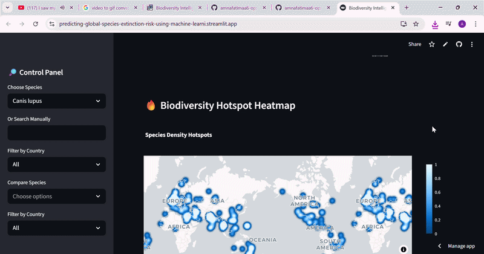
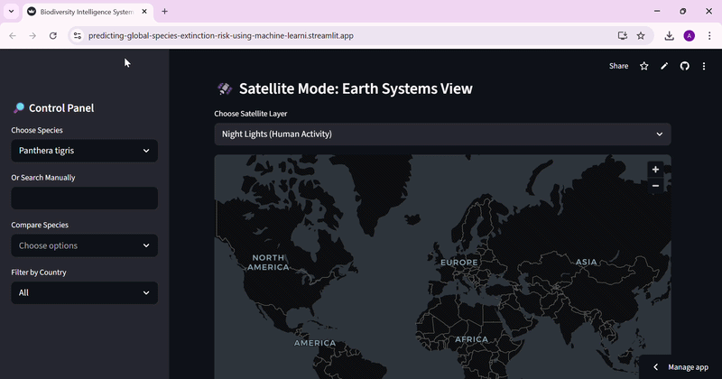
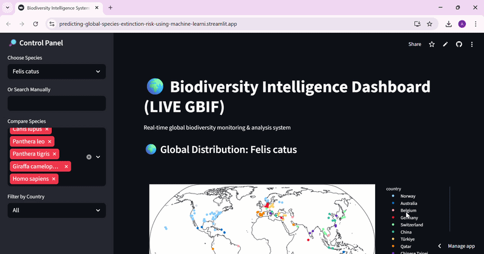

# Exploring Species Population Change with Machine Learning

This project explores historical animal population data to understand how population trends can be grouped into different risk categories using machine learning.

I used Python to clean and analyse the data, create population-change features, compare classification models, and explore how uneven data collection can affect the interpretation of biodiversity patterns.

The project is an educational analysis, not a validated system for predicting real-world extinction risk.

-------------------------------------------------------------------------------------------------------------------------------------

# Link
https://predicting-global-species-extinction-risk-using-machine-learni.streamlit.app/

### Demo 1

---

### Demo 2

---

### Demo 3

---

### Demo 4

------------------------------------------------------------------------------------------------------------------------------------------------------

## Project Links

- **GitHub repository:** [View the code](https://github.com/amnafatimaa6-ops/Predicting-Global-Species-Extinction-Risk-Using-Machine-Learning)
- **Jupyter notebook:** [Endangered_species.ipynb](https://github.com/amnafatimaa6-ops/Predicting-Global-Species-Extinction-Risk-Using-Machine-Learning/blob/main/Endangered_species.ipynb)
- **Interactive dashboard:** [Open the Streamlit app](https://predicting-global-species-extinction-risk-using-machine-learni.streamlit.app/)
- **Demo screenshots:** [View the demos folder](https://github.com/amnafatimaa6-ops/Predicting-Global-Species-Extinction-Risk-Using-Machine-Learning/tree/main/demos)

**Important:** The notebook and the live dashboard are separate parts of this repository. The notebook contains the machine learning experiments. The dashboard uses live biodiversity occurrence records from GBIF and does not currently use the notebook's trained model.

##  The Question Behind the Project

Species populations can change over time, but studying these changes is not always straightforward. Historical datasets may contain missing values, uneven geographical coverage, and different amounts of monitoring across countries.

I wanted to explore this question:

**Can historical population changes be used to classify species into different population-trend risk categories, and what limitations appear when interpreting the results?**

##  Dataset and Preparation

The notebook uses a file named `LPD_2024_public.csv`.

After removing an irrelevant column, standardising column names, and checking missing values, I reshaped the yearly population data from wide format into long format.

The processed dataset contained:

- **420,356 records**
- **5,176 unique species**
- **202 countries**

Missing population observations were removed. I then averaged population values across locations for each species and year, allowing me to compare population values for 1970 and 2020.

These figures describe the processed dataset before the final filtering used for model training.

The CSV file is not included in the repository. To reproduce the notebook, you need to obtain the dataset separately and update the file path to match your environment.

##  Creating Population-Change Features

I calculated the relative population change between 1970 and 2020:
$$
\text{Change Rate} = \frac{P_{2020} - P_{1970}}{P_{1970}}
$$

I used this value to create three project-defined categories:

- **Stable:** change rate greater than -0.2
- **Vulnerable:** change rate greater than -0.5 and up to -0.2
- **Endangered:** change rate of -0.5 or lower

These are simplified categories created for this project. They are **not official IUCN Red List classifications**.

I also created features representing absolute population change, growth ratio, and log-transformed population change.

A minimum baseline population of 10 was applied, and invalid or infinite values were removed before model training.

##  Machine Learning Approach

I compared three classification models using a stratified 80/20 train-test split with `random_state=42`:

- Logistic Regression
- Random Forest
- Gradient Boosting

The notebook used five input features:

- Population in 1970
- Population in 2020
- Absolute population change
- Growth ratio
- Log-transformed population change

The target was the project-defined risk category. I used `LabelEncoder` to convert the category labels into numerical values.

`StandardScaler` was fitted on the training features and then applied to the test features.

##  Results

The notebook reported the following test-set accuracy:

| Model | Accuracy |
|---|---:|
| Logistic Regression | 91.67% |
| Random Forest | 95.83% |
| Gradient Boosting | 95.83% |

Random Forest was selected as the final model in the notebook. Feature-importance analysis highlighted growth ratio and log change as influential features.

The Random Forest classification report showed an overall macro F1-score of approximately 0.88. The least-represented class had only two test samples, with a recall of 0.50, so the overall accuracy needs to be interpreted carefully.

### An important limitation of these results

The reported accuracy is not evidence that the model can independently predict future extinction risk.

The target categories were created from the population values for 1970 and 2020. The model then received those same values and features calculated from them. This creates a circular relationship between the inputs and the target: the model can learn the rule used to assign the categories.

The test score therefore measures how well the model reproduces these project-defined categories on a small held-out sample. It does not establish reliable forecasting performance on unseen species or future population data.

##  Exploring Geographical Patterns and Data Bias

The notebook also examines the distribution of species records across countries and continents.

In this separate analysis, I used a simplified growth-ratio rule to group records by population change and then compared the resulting country counts.

The notebook found that some countries, including the United States and the United Kingdom, contributed relatively high counts within this dataset-defined group. These counts do not establish that those countries have the highest real-world extinction rates.

Differences in monitoring effort, historical records, and reporting coverage may influence the patterns. The analysis raises the question of whether areas with more available data are more visible in the results.

The geographical findings should therefore be treated as exploratory, not as a global ranking of extinction severity.

##  Interactive Biodiversity Dashboard

The repository also includes a Streamlit application that explores live biodiversity occurrence records.

The app currently provides:

- Species search and comparison
- Geographic distribution maps
- Occurrence heatmaps
- Observation trends over time
- Country-level record summaries
- A simple observation-trend indicator
- External NASA Earth-data map layers for night lights and vegetation index
- A map overlay based on the distribution of occurrence records

The dashboard retrieves occurrence records from the GBIF API and uses the number and distribution of records to create some of its visual indicators.

**The dashboard's risk indicators are simplified proxies, not predictions from the notebook's Random Forest model.** Changes in recorded observations can reflect changes in data collection as well as changes in nature. The satellite layers are map imagery; they are not used as input features by the notebook's trained classifier.

##  Tools Used

- Python
- Pandas and NumPy
- Matplotlib and Seaborn
- Scikit-learn
- Jupyter Notebook
- Streamlit
- Plotly
- PyDeck
- GBIF API

## What I Learned

This project helped me practise cleaning a large dataset, reshaping time-based data, creating features, training classification models, comparing evaluation metrics, and interpreting visualisations.

One of my main takeaways was that a high accuracy score is not enough to establish that a model answers the scientific question we intended to ask. The way a target is defined, the features supplied to a model, the number of test samples, and the quality of the underlying data all matter.

I also learned that geographical patterns need context. More records in a country do not automatically mean greater biodiversity loss there.

##  Limitations

Although this project helped me explore population trends and machine learning, there are several limitations to consider.

- **Simplified risk categories:** The Stable, Vulnerable, and Endangered labels were created using population changes between 1970 and 2020. They are project-defined categories, not official IUCN conservation assessments.

- **Possible target leakage:** The target labels are calculated from population values that are also included in the model's input features. This means the models can learn the rule used to create the labels rather than independently predict extinction risk. Therefore, the reported accuracy should not be interpreted as evidence of reliable real-world prediction.

- **Small test set:** The test set contains only 24 samples. With so few samples, the results can change considerably depending on which observations are selected for testing.

- **Limited evaluation:** The notebook compares three classifiers using a single stratified train-test split. It does not establish how well the models would perform on entirely new species or future population data.

- **Missing and uneven data:** Removing missing population observations makes the analysis easier to perform, but it can also exclude useful information. Differences in monitoring and reporting across countries may affect the patterns found in the dataset.

- **Geographical interpretation:** The country-level analysis is exploratory. A higher number of records or species in a group does not automatically indicate a higher real-world extinction rate.

- **Separate notebook and dashboard:** The machine learning experiments and the Streamlit dashboard are not integrated. The dashboard retrieves species-occurrence records from GBIF and uses its own simplified indicators rather than the trained classifier from the notebook.

These limitations mean that the project should be understood as an educational exploration of population data and classification methods, rather than a validated extinction-risk prediction system.

##  Future Work

There are several ways I would like to improve this project:

- **Create a more independent prediction task:** Use features that are available before the prediction period and avoid calculating the target directly from the same information supplied to the model.

- **Test on future data:** Train the model using earlier years and evaluate it against later observations to investigate whether it can identify population trends beyond the data used for training.

- **Evaluate on unseen species:** Keep some species completely separate from model development to test whether the approach generalises to species it has not encountered.

- **Improve model evaluation:** Use additional evaluation metrics and repeated validation, where appropriate, instead of relying on accuracy from one small test set.

- **Compare with independent conservation assessments:** Where suitable data are available, compare the results with official conservation assessments, such as IUCN Red List categories, while accounting for the differences between population decline and extinction risk.

- **Investigate data quality:** Examine missing observations, differences in monitoring effort, and geographical imbalances to better understand how they affect the analysis.

- **Improve the interactive dashboard:** Explore the possibility of connecting a properly evaluated model to the Streamlit application, while keeping live occurrence records, population estimates, and model predictions clearly distinguished.

These are proposed improvements, not features already completed in the current project.

##
